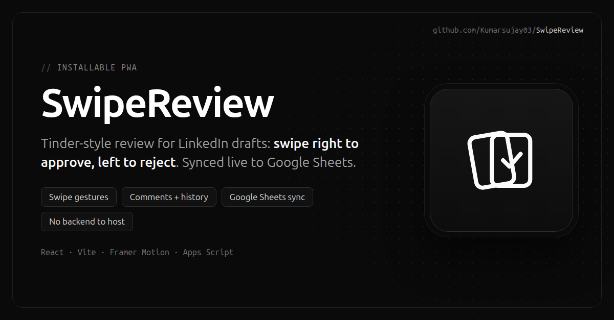

# SwipeReview

<p align="center"></p>

A Tinder-style content review app for approving and rejecting LinkedIn posts with swipe gestures. Content is pulled from a Google Sheet, and every decision (with the reviewer's name and optional comment) is written straight back to it. No dedicated backend to host, Google Apps Script does the work.

## Features

- Swipeable card interface (swipe right to approve, left to reject)
- Approve / reject with gestures or buttons
- Add comments and attribute each decision to the logged-in reviewer
- History view of everything already reviewed
- Real-time sync with Google Sheets
- Installable PWA (works offline-friendly on mobile)

## Tech Stack

- React 18 + Vite
- React Spring and Framer Motion (animations)
- @use-gesture/react (swipe handling)
- Lucide React (icons)
- Google Apps Script (serverless backend on top of Google Sheets)

## Getting Started

### Prerequisites

- Node.js 18 or newer
- A Google account (for the Google Sheets backend)

### 1. Install dependencies

```bash
npm install
```

### 2. Set up the Google Sheets backend

Follow the step-by-step guide in [`SHEETS_SETUP.md`](./SHEETS_SETUP.md). It walks you through creating the sheet, deploying `google-apps-script.js` as a web app, adding reviewer accounts, and getting your web app URL.

Reviewer accounts live in a `Users` tab of the same spreadsheet and are created from a **SwipeReview > Add / update reviewer** menu that the script adds. Only a salted password hash is stored, and sign-in is checked by the Apps Script backend, so no emails or passwords ship in the frontend bundle.

### 3. Configure the API URL

Copy the example env file and add your deployed web app URL:

```bash
cp .env.example .env
```

Then edit `.env`:

```
VITE_SHEETS_API_URL=https://script.google.com/macros/s/XXXXXXXX/exec
```

If you skip this step, the app runs in demo mode against built-in mock data: any email and password will sign you in, so you can still try the UI.

### 4. Run locally

```bash
npm run dev
```

Open the URL Vite prints (usually `http://localhost:5173`).

### 5. Build for production

```bash
npm run build
npm run preview   # preview the production build locally
```

## Deployment

The project is set up for Vercel (see `vercel.json`):

1. Push this repo to GitHub.
2. Import the project in Vercel.
3. Add the `VITE_SHEETS_API_URL` environment variable in the Vercel project settings.
4. Deploy.

## Project Structure

```
src/
  components/    Login, CardStack, History
  services/      sheets.js  (Google Sheets client)
  styles/        component CSS
google-apps-script.js   Backend to paste into Google Apps Script
SHEETS_SETUP.md         Full backend setup guide
```

## Configuration Notes

- The Google Apps Script web app URL is read from `VITE_SHEETS_API_URL` and is never committed to the repo.
- Reviewer credentials are verified server-side by the Apps Script `login` action against the `Users` tab (salted, iterated SHA-256). Never hard-code credentials in the frontend: anything in `src/` ends up in the public bundle.
- The deployed script is accessible to anyone with the URL, so treat the URL as a secret and only put non-sensitive content in the sheet. See the Security Notes in `SHEETS_SETUP.md`.

## License

Released under the [MIT License](./LICENSE).
